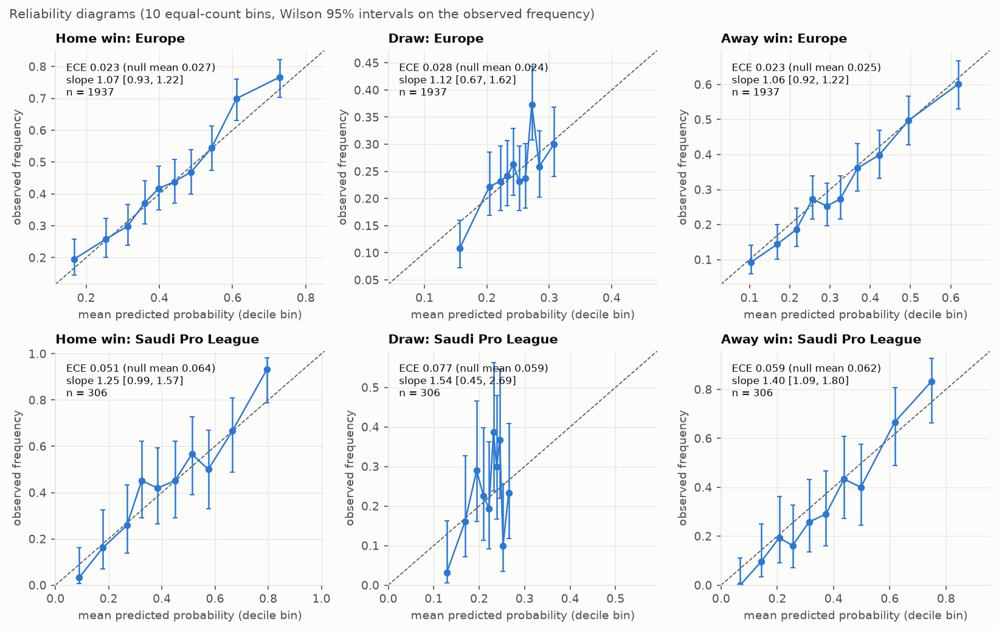
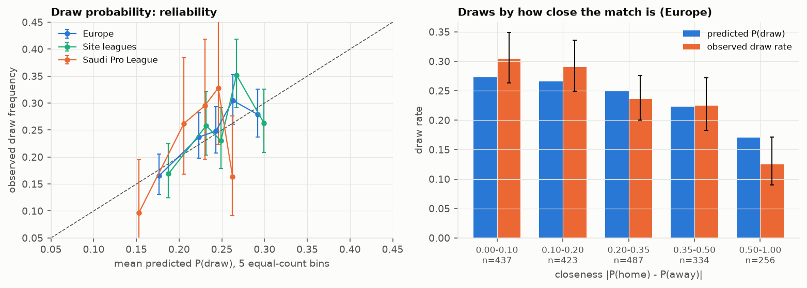
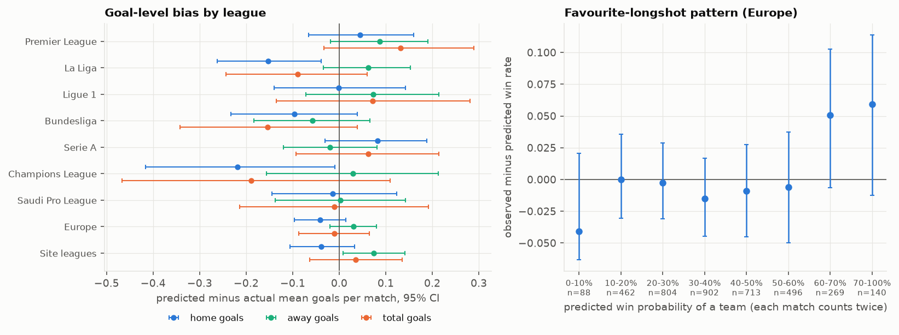
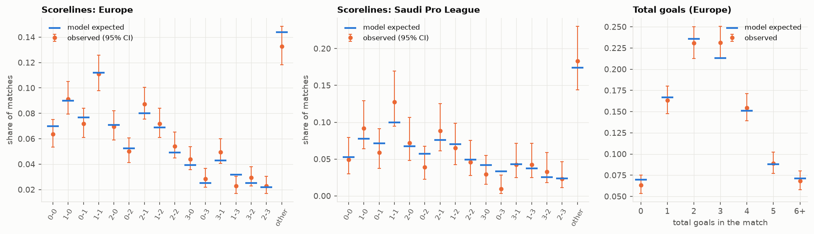
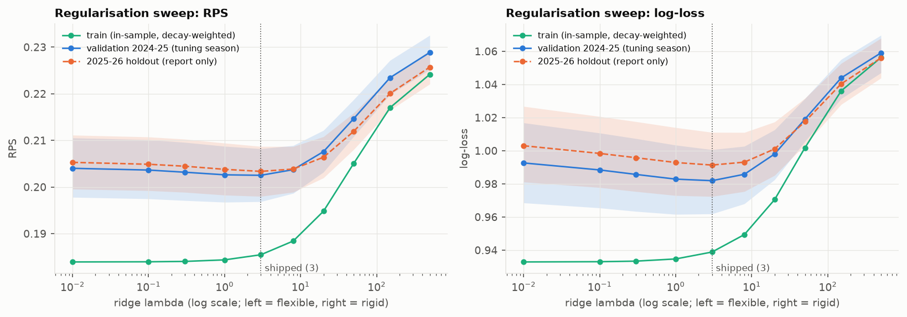
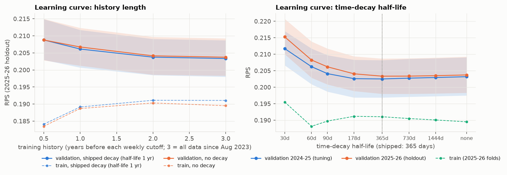
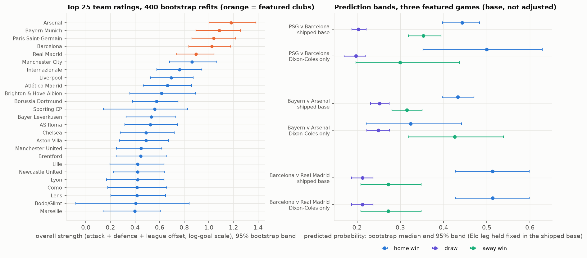
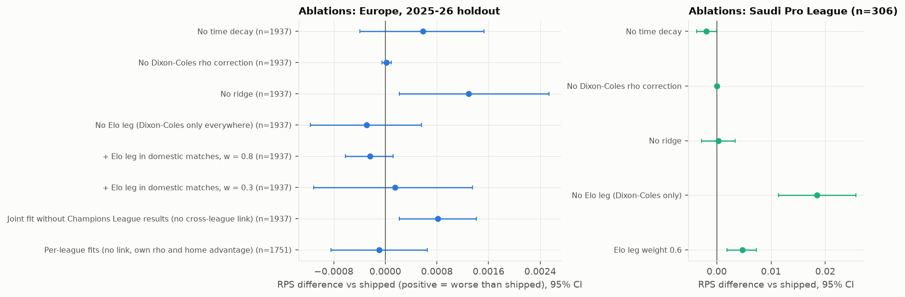
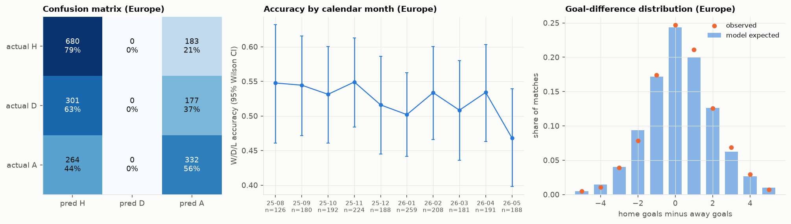

# Evaluation of the Ihtimal match predictor

Generated by `evaluation/run_eval.py` (`full run`); every number below is computed there and read from `evaluation/results.json`, none is typed by hand. Data through 2026-10-18 (7,121 matches in `data/matches.csv`). Nothing in the model, `site/`, the three locked featured files or `locks.json` was changed by this evaluation.

## Model card

|  |  |
|---|---|
| Model | `ihtimal-v1.0`: a time-decayed Dixon-Coles goals model (one joint fit for the big-5 leagues and the Champions League; a separate fit for the Saudi Pro League), optionally log-blended with an Elo leg. Output: W/D/L probabilities, expected goals and a 0-8 by 0-8 scoreline grid, from which the published pick (most likely result, then most likely score within it) is taken. |
| Intended use | Statistical W/D/L probabilities and a most-likely score for upcoming matches in the Saudi Pro League, Premier League, La Liga and Ligue 1 (plus two Champions League featured games), shown for fun and learning to a general audience, with the track record published match by match. |
| Data | openfootball (public domain) and ESPN public scoreboard results, 1 Aug 2023 onwards (7,121 regulation-time results). No odds, no market data, no xG in the base model. Training for each prediction uses only matches strictly before it. |
| Method | Europe: xi = 0.0019 per day (half-life 365 days), ridge 3 on team attack/defence, league offsets linked through Champions League matches, Elo weight 0% in domestic matches and 70% in the Champions League. Saudi: xi = 0.012, ridge 8, rho fixed from a slow-decay pass, Elo weight 70%. All chosen on 2024-25 only. |
| Evaluation | One pre-registered holdout season (2025-26), weekly walk-forward refits (every fitted object rebuilt each Monday from earlier matches only), 2,000 match-level bootstrap resamples (seed 2026), 95% percentile intervals. Same-season results are not used for any choice. |

**Headline metrics on the 2025-26 holdout (95% bootstrap intervals)**

| Group | W/D/L accuracy | Exact-score hit (published pick) | RPS | Log-loss | Brier |
|---|---|---|---|---|---|
| Europe (n=1,937) | 52.2% [50.0, 54.4] | 10.5% [9.1, 12.0] | 0.2036 [0.1984, 0.2090] | 0.9920 [0.9734, 1.0114] | 0.5910 [0.5779, 0.6046] |
| Site leagues (n=1,065) | 50.2% [47.2, 53.3] | 11.3% [9.4, 13.2] | 0.2061 [0.1992, 0.2136] | 1.0040 [0.9799, 1.0297] | 0.5995 [0.5825, 0.6176] |
| Saudi Pro League (n=306) | 57.5% [52.0, 63.1] | 8.5% [5.6, 11.8] | 0.1770 [0.1634, 0.1919] | 0.8970 [0.8415, 0.9526] | 0.5275 [0.4881, 0.5679] |

Reference points (Europe): league base rates RPS 0.2298, Elo only 0.2050, uniform 0.2366; home-win-always accuracy 44.6%.

**Known limitations and biases (all quantified below)**

* Level with a plain Elo model, not better: RPS difference to Elo-only -0.0013 [-0.0032, +0.0005] in Europe. No comparison with bookmaker prices was made, so there is no evidence it can beat a market.
* Never picks a draw (24.7% of matches are draws); its draw probabilities are right on average (24.3% predicted) but too flat across match closeness.
* Mildly under-confident: calibration slope 1.07 (home) in Europe; favourites at 60% or more win 73.8% against 68.5% predicted.
* Home advantage understated in the three site leagues in 2025-26 (home wins 45.9% observed against 43.0% predicted; La Liga drives it).
* Parameter and structure uncertainty: on the three featured games the 95% bootstrap band on a home-win probability has a half-width of 9 to 14 points for the Dixon-Coles leg (50.0% [35.3, 62.9] for PSG-Barcelona). On the two Champions League games the Dixon-Coles-only and shipped (70% Elo) home-win estimates differ by 5.7 and 11.1 points, more than the shipped base's own band half-width of about 4 points (reviewer-corrected).
* Exact scores: about 1 in 9.5 (Europe), 1 in 11.8 (Saudi). Saudi results rest on 306 matches and have wide intervals; its slopes are under-confident (too flat).
* The injury and xG adjustments on the three featured games are not part of this evaluation (they cannot be backtested).
* One holdout season: results describe 2025-26, and subgroup tables (by league, month, band) are exploratory and subject to multiple-comparison noise.

**What NOT to use it for**

* **Betting or staking of any kind.** It was never tested against odds, is statistically indistinguishable from a simple Elo model, and a 95% band of 9 to 14 points on a home-win probability means any apparent "edge" over a bookmaker is inside the noise.
* Treating the most-likely score as a forecast of the score (it hits about one match in 9), or a probability of 40-50% as a pick (the model's accuracy in that favourite band is 43.8%).
* Matches involving teams with little history in the data (fewer than about 20 matches in the prior year), leagues outside the fitted pool, in-play prediction, individual-player or team-news judgements.

## Key findings

1. **Headline accuracy.** On the 2025-26 holdout (weekly refits, never tuned on) the model called W/D/L correctly in 52.2% [50.0, 54.4] of 1,937 European matches, 50.2% [47.2, 53.3] of 1,065 matches in the three site leagues and 57.5% [52.0, 63.1] of 306 Saudi matches. The published exact-score pick hit 10.5% [9.1, 12.0] (Europe), 11.3% [9.4, 13.2] (site leagues) and 8.5% [5.6, 11.8] (Saudi).
2. **Skill over naive baselines is real.** RPS 0.2036 [0.1984, 0.2090] (Europe) against league base rates 0.2298: difference -0.0262 [-0.0315, -0.0211], bootstrap p <0.001, Diebold-Mariano p <0.001. The same holds in the site leagues (-0.0208 [-0.0277, -0.0135]) and in Saudi (-0.0574 [-0.0722, -0.0421]). Accuracy beats "home win always" (44.6%) by +7.7 pp in Europe.
3. **Not distinguishable from plain Elo.** Shipped minus Elo-only RPS: Europe -0.0013 [-0.0032, +0.0005] (DM p 0.182), site leagues -0.0012 [-0.0041, +0.0013], Saudi +0.0012 [-0.0019, +0.0041]. The goals model earns no measurable edge over a simple Elo ordered-logit mapping (two thresholds and a slope on the Elo difference) (reviewer-corrected) on this season; the honest description is "as good as Elo, with scorelines".
4. **Calibration is good on average, with a mild under-confidence.** Per-class ECE in Europe is 0.023 / 0.028 / 0.023 (home / draw / away) against 0.027 / 0.024 / 0.025 expected from sampling noise alone (simulation p 0.72 / 0.22 / 0.67). Calibration slopes are 1.07 / 1.12 / 1.06 (all three intervals contain 1; direction: under-confident (too flat)). A one-parameter sharpening fitted on 2024-25 (T = 1.05) would move RPS by only -0.0001 [-0.0004, +0.0001], so it is not worth shipping. In the three site leagues, though, the away-win and draw ECEs (0.056 and 0.048) are above the 95th percentile expected from noise (simulation p 0.012 and 0.038): this is the home-advantage miss of finding 6 (away wins over-predicted, CITL -0.191 [-0.332, -0.049]) (reviewer-corrected).
5. **Draws.** Mean P(draw) is 24.3% against an observed draw rate of 24.7% (calibration-in-the-large +0.018 [-0.088, +0.127]). The model never names a draw as the most likely result (0 of 1,937 matches), so draw recall is 0% by construction. P(draw) is slightly too flat across match closeness: the closest matches drew 30.4% against 27.3% predicted, the most lopsided 12.5% against 17.0% (both inside their 95% intervals).
6. **Home advantage is understated in the three site leagues.** Home wins 45.9% observed against 43.0% predicted (-2.9 pp [-5.7 pp, -0.1 pp], predicted minus observed); away wins 28.6% against 32.3%. Predicted minus actual home goal difference is -0.113 [-0.207, -0.017] goals per match, driven by La Liga (-0.215 [-0.354, -0.073]). Five separate per-league fits (each with its own home advantage, but also its own rho and no Champions League data) scored the same as the joint fit on the 1,751 domestic matches of all five leagues (RPS -0.0001 [-0.0008, +0.0006]). A per-league home advantage estimated from earlier seasons therefore did not fix this. That fits 2025-26 being an unusual home season in La Liga, but one season cannot separate that from a lasting shift (reviewer-corrected).
7. **Goal levels are unbiased overall.** Predicted minus actual total goals per match in Europe: -0.010 [-0.087, +0.065]. 2 of 21 league-by-(home/away/total) intervals exclude zero (La Liga home (-0.152 [-0.262, -0.039]); Champions League home (-0.219 [-0.416, -0.009])); about 1.1 would be expected by chance.
8. **Favourite-longshot pattern (model compresses probabilities).** Teams the model gave at least 60% won 73.8% of the time against 68.5% predicted (+5.4 pp [+1.2, +9.8]), while sides under 10% won 3.4% against 7.5% (n=88, interval 1.2% to 9.5%). The pooled team-side calibration slope is 1.10 [0.97, 1.22]. The effect is small and the intervals are wide.
9. **Scoreline frequencies match the model in Europe and Saudi, less well in the site leagues (reviewer-corrected).** Chi-square over 15 named scorelines plus "other": Europe p = 0.34, Saudi p = 0.55, site leagues p = 0.021 (cells with |z| above 2: 3-0 more than modelled (z +2.6), 1-3 fewer than modelled (z -2.2), other fewer than modelled (z -2.8)). Poisson variance is adequate: the Pearson dispersion ratio for total goals is 0.996 [0.932, 1.067] (1 = Poisson), home goals 0.976, away goals 0.946; league values range from 0.85 to 1.22; the total-goals interval excludes 1 on the low side for La Liga and on the high side for Ligue 1. Home-away residual correlation 0.044 [-0.003, 0.090], so the independence assumption is not visibly violated in Europe as a whole. In the site leagues it is 0.065 [0.003, 0.131], small but just above zero (reviewer-corrected).
10. **Bias-variance (ridge).** On the 2024-25 tuning season validation RPS is lowest at lambda = 3 (0.2025); the shipped value is 3. In-sample RPS rises from 0.1839 (lambda 0.01) to 0.1855 (3) and 0.2051 (50) while the train-to-validation gap shrinks from 0.0201 to 0.0170 to 0.0096: too little ridge overfits (validation 0.2040), too much underfits (0.2147 at 50). The valley is flat between lambda 1 and 8. The holdout, shown for information only, agrees (lowest at lambda = 3).
11. **Learning curves.** Holdout RPS falls with more history: 0.2088 (6 months), 0.2061 (1 year), 0.2038 (2 years), 0.2034 (all data, 2.0 to 2.8 years); the gain shrinks at each step (0.0027, 0.0024, 0.0004). The last step is small and was not tested against noise, so more history of the same kind would help little (reviewer-corrected). Time-decay half-life: very short memory is costly (30 days: 0.2153) but the curve is flat from about 365 days to no decay at all (shipped 365 days: 0.2034). Removing decay costs +0.0006 [-0.0004, +0.0015], not detectable.
12. **Parameter stability.** Over 400 bootstrap refits at the live snapshot, the median standard deviation of a team's attack rating is 0.083 and of its defence rating 0.082 (log-goal scale; between-team spread 0.245 and 0.164). Attack ratings are 0.87 reliable and defence ratings 0.73, so defence is the noisier half. Teams with fewer than 25 matches in the last year have about 2.2 times the attack-rating uncertainty of teams with 40 or more (0.144 against 0.067). Only 4 teams are in the first group, so the ratio is rough (reviewer-corrected).
13. **Prediction uncertainty on the featured games.** Home-win probability from the Dixon-Coles leg alone, with 95% bootstrap bands: PSG-Barcelona 50.0% [35.3, 62.9], Bayern-Arsenal 32.4% [22.1, 44.1], Barcelona-Real Madrid 51.3% [42.7, 59.9]. The shipped Champions League base looks tighter (44.3% [39.8, 48.3] and 43.3% [39.8, 47.1]) only because the Elo leg (70% weight) is held fixed in the bootstrap. The gap between the Dixon-Coles-only and shipped point estimates (PSG-Barcelona home 50.0% against 44.3%; Bayern-Arsenal home 32.1% against 43.2%) exceeds the half-width of the shipped-base band. Half-widths of the 95% bands on the home-win probability are 9 to 14 points for the Dixon-Coles leg and 4 to 9 points for the shipped base (Elo fixed), so any single W/D/L percentage carries an uncertainty of that order, before counting the disagreement between the two legs.
14. **Ablations.** Removing time decay (+0.0006 [-0.0004, +0.0015]), removing the Dixon-Coles rho correction (+0.0000 [-0.0001, +0.0001]), removing the Elo leg in the Champions League (-0.0003 [-0.0012, +0.0006]) or adding it to domestic matches (w = 0.8: -0.0002 [-0.0006, +0.0001]; w = 0.3: +0.0001 [-0.0011, +0.0014]) all change RPS by less than the noise. Two components do matter: the ridge (+0.0013 [+0.0002, +0.0025] without it, p 0.014) and the Champions League link (+0.0008 [+0.0002, +0.0014]; on the 186 Champions League matches alone +0.0048 [+0.0008, +0.0091]). 109 of those 186 matches involve a club from outside the big five. Without Champions League results the goals model has no data on those clubs at all, so much of this gain comes from having any goals-model rating for them, not only from linking league strengths (reviewer-corrected). Five separate per-league fits with no Champions League data score -0.0001 [-0.0008, +0.0006] against the joint fit on domestic matches: the cross-league pooling neither helps nor hurts domestic predictions.
15. **Saudi model.** It leans on its Elo leg: dropping the leg costs +0.0185 [+0.0114, +0.0256] RPS. The pre-registered fast decay is, if anything, slightly worse than no decay on the holdout (-0.0019 [-0.0037, -0.0000], bootstrap p 0.046); this is a post-hoc diagnostic on 306 matches, so nothing is changed, but it is worth rechecking with 2026-27 data. Saudi calibration slopes are 1.25 (home) and 1.40 (away), i.e. under-confident (too flat), with wide intervals.
16. **What the model predicts.** Of 1,937 European matches it picked home in 64.3%, away in 35.7% and draw in 0.0%, against actual shares of 44.6% / 24.7% / 30.8%. Recall is 78.8% for home wins and 55.7% for away wins. Accuracy rises with favourite strength from 40.8% (favourite under 40%) to 82.1% (favourite 70% or more); in the 40-50% band it is only 43.8%.
17. **No visible cold-start penalty.** August-October RPS 0.1963 against 0.2062 for the rest of the season (difference -0.0099 [-0.0219, +0.0022]; early-season matches were, if anything, easier). By matches already played by the less-experienced team: RPS 0.2029 (0-2 games) against 0.2078 (20+). The weakest month is 2026-05 (RPS 0.2200, accuracy 46.8%), but May against the rest is +0.0181 [-0.0013, +0.0377], an exploratory comparison among 10 months that includes zero.
18. **The 15 worst misses are ordinary tail events.** All gave the actual outcome at most 11.9%; 11 were longshot wins and 4 were draws by a favourite (mean favourite probability 77%), 10 of the 15 were away wins, 3 involved a team with at most five earlier games that season and only 1 was a 3-goal-or-more margin. Counting every match, 15 realised outcomes had a predicted probability under 12% against 16.0 implied by the probabilities themselves (110 against 120.3 under 20%): the model is not surprised more often than it says it should be.
19. **Goal-difference errors are symmetric and slightly narrower than the model implies.** Actual minus predicted goal difference: mean 0.072 [-0.000, 0.145], SD 1.612 against 1.674 implied by the score grids, skew -0.00, excess kurtosis +0.22, 5th to 95th percentile -2.54 to +2.86; mean absolute error 1.259 [1.214, 1.304] goals.
20. **Reproducibility.** The regenerated 2025-26 holdout matches the stored backtest probabilities to 1e-16, and the bootstrap refit at the live snapshot reproduces the three locked `base` predictions to within 4.1e-07 (rounding of the locked files).

## 0. Setup and reproducibility

* **Holdout and refits.** The 2025-26 season (1 Aug 2025 to 31 Jul 2026) exactly as pre-registered in `BACKTEST_SPEC.md`: for each Monday 00:00 UTC cutoff every fitted object is rebuilt from matches strictly before it and the following 7 days are predicted. Refits are cheap (37 weekly folds of the European model, Elo leg and baselines took 1.7 seconds), so **every analysis here uses weekly refits**; no cheaper schedule (monthly or similar) was needed. The whole evaluation ran in 58 seconds.
* **Reuse of existing outputs.** The shipped settings are read from `data/backtest_eu.json` and `data/backtest_spl.json`. The shipped holdout predictions are regenerated by the same code path as `model/backtest.py` (the stored CSVs do not contain expected goals, Elo or base-rate probabilities, which the bias and baseline analyses need) and asserted equal to `data/backtest_*_2025-26_matches.csv`: maximum absolute probability difference 9.7e-17; RPS 0.20365 (Europe) and 0.17701 (Saudi) against 0.20365 and 0.17701 in the stored JSON.
* **Groups.** Europe = Premier League, La Liga, Ligue 1, Bundesliga, Serie A and Champions League (1,937 matches); site leagues = the Premier League, La Liga and Ligue 1 (1,065); Saudi Pro League (306). Champions League predictions use the Elo blend as shipped.
* **Bootstrap.** Match-level resampling, 2,000 replicates, seed 2026, 95% percentile intervals. The same resampled indices are used for every comparison on the same group, so differences are paired. p-values from the bootstrap are two-sided by percentile inversion (floor 1/2,000). Diebold-Mariano tests use Newey-West variance (lag n^(1/3)) with the Harvey-Leybourne-Newbold small-sample correction and a Student-t reference. As a robustness check intervals are also computed by resampling whole weekly folds (block bootstrap).
* **Calibration null.** ECE is positively biased in small samples, so each observed ECE is compared with its distribution under perfect calibration (outcomes simulated 1,000 times from the model's own probabilities, same bins).
* **Parameter-stability bootstrap.** 400 refits of the live European model (cutoff 2026-10-19, the fit behind the featured predictions), each on 6,125 training matches resampled with replacement (dates kept, so time-decay weights are kept).

## 1. Headline metrics

Exact-score hit = the published pick (most likely result, then the most likely score within it). Top-score hit = the single most likely cell of the grid. RPS, log-loss and Brier: lower is better. Intervals are 95% bootstrap.

| Group | n | W/D/L accuracy | Exact-score hit | Top-score hit | RPS | Log-loss | Brier |
|---|---|---|---|---|---|---|---|
| Europe | 1,937 | 52.2% [50.0, 54.4] | 10.5% [9.1, 12.0] | 11.8% [10.3, 13.2] | 0.2036 [0.1984, 0.2090] | 0.9920 [0.9734, 1.0114] | 0.5910 [0.5779, 0.6046] |
| Site leagues | 1,065 | 50.2% [47.2, 53.3] | 11.3% [9.4, 13.2] | 13.2% [11.3, 15.2] | 0.2061 [0.1992, 0.2136] | 1.0040 [0.9799, 1.0297] | 0.5995 [0.5825, 0.6176] |
| Saudi Pro League | 306 | 57.5% [52.0, 63.1] | 8.5% [5.6, 11.8] | 12.1% [8.5, 15.7] | 0.1770 [0.1634, 0.1919] | 0.8970 [0.8415, 0.9526] | 0.5275 [0.4881, 0.5679] |

By competition (same metrics):

| Competition | n | W/D/L accuracy | Exact-score hit | RPS | Log-loss |
|---|---|---|---|---|---|
| Premier League | 380 | 46.6% [41.6, 51.6] | 8.9% [6.3, 11.8] | 0.2084 [0.1971, 0.2191] | 1.0266 [0.9889, 1.0670] |
| La Liga | 380 | 52.4% [47.4, 57.4] | 14.5% [11.1, 17.9] | 0.2023 [0.1899, 0.2146] | 0.9843 [0.9454, 1.0236] |
| Ligue 1 | 305 | 52.1% [46.6, 57.7] | 10.2% [6.9, 13.8] | 0.2080 [0.1948, 0.2228] | 1.0005 [0.9544, 1.0526] |
| Bundesliga | 306 | 55.6% [50.0, 61.1] | 8.2% [5.2, 11.4] | 0.1951 [0.1816, 0.2093] | 0.9712 [0.9167, 1.0221] |
| Serie A | 380 | 51.8% [47.1, 56.8] | 12.1% [8.9, 15.5] | 0.2030 [0.1907, 0.2152] | 1.0008 [0.9592, 1.0419] |
| Champions League | 186 | 59.1% [52.2, 66.7] | 7.0% [3.8, 10.8] | 0.2050 [0.1852, 0.2257] | 0.9395 [0.8683, 1.0067] |
| Saudi Pro League | 306 | 57.5% [52.0, 63.1] | 8.5% [5.6, 11.8] | 0.1770 [0.1634, 0.1919] | 0.8970 [0.8415, 0.9526] |

Intervals for single competitions are wide (186 to 380 matches each); differences between leagues are mostly within noise.


## 2. Baselines and significance

Baselines: **home win always** (accuracy only), **league base rates** (home/draw/away frequencies of the same competition in all earlier matches, Laplace-smoothed, refit each week), **Elo only** (ordered logit on the Elo difference, refit each week, no scoreline grid), plus uniform and the Dixon-Coles-only leg for reference.

**Europe (big-5 + UCL), n = 1,937**

| Model | RPS | Log-loss | Brier | W/D/L accuracy |
|---|---|---|---|---|
| Shipped model | 0.2036 [0.1984, 0.2090] | 0.9920 [0.9734, 1.0114] | 0.5910 [0.5779, 0.6046] | 52.2% [50.0, 54.4] |
| Dixon-Coles only (w=1) | 0.2034 [0.1980, 0.2087] | 0.9914 [0.9724, 1.0111] | 0.5903 [0.5771, 0.6042] | 52.5% [50.3, 54.6] |
| Elo only | 0.2050 [0.1987, 0.2113] | 0.9960 [0.9739, 1.0186] | 0.5933 [0.5779, 0.6091] | 51.4% [49.2, 53.5] |
| League base rates | 0.2298 [0.2267, 0.2330] | 1.0677 [1.0570, 1.0793] | 0.6456 [0.6385, 0.6530] | 44.6% [42.3, 46.7] |
| Uniform 1/3 | 0.2366 [0.2333, 0.2398] | 1.0986 [1.0986, 1.0986] | 0.6667 [0.6667, 0.6667] | 44.6% [42.3, 46.7] |
| Home win always | - | - | - | 44.6% [42.3, 46.7] |

| Shipped minus ... | RPS difference [95% CI] | Bootstrap p | DM statistic | Week-block 95% CI (RPS) | Log-loss difference [95% CI] | DM p (log-loss) |
|---|---|---|---|---|---|---|
| vs League base rates | -0.0262 [-0.0315, -0.0211] | <0.001 | -9.68 (p <0.001) | [-0.0313, -0.0206] | -0.0757 [-0.0920, -0.0602] | <0.001 |
| vs Elo only | -0.0013 [-0.0032, +0.0005] | 0.150 | -1.33 (p 0.182) | [-0.0035, +0.0008] | -0.0040 [-0.0103, +0.0026] | 0.267 |
| vs Uniform 1/3 | -0.0330 [-0.0385, -0.0273] | <0.001 | -11.21 (p <0.001) | [-0.0384, -0.0272] | -0.1066 [-0.1252, -0.0873] | <0.001 |
| vs Dixon-Coles only (w=1) | +0.0003 [-0.0006, +0.0012] | 0.486 | +0.71 (p 0.480) | [-0.0005, +0.0011] | +0.0007 [-0.0020, +0.0034] | 0.604 |
| vs Home win always (accuracy) | +7.7 pp [+5.4 pp, +10.0 pp] | <0.001 | - | - | - | - |

**Site leagues (EPL + La Liga + Ligue 1), n = 1,065**

| Model | RPS | Log-loss | Brier | W/D/L accuracy |
|---|---|---|---|---|
| Shipped model | 0.2061 [0.1992, 0.2136] | 1.0040 [0.9799, 1.0297] | 0.5995 [0.5825, 0.6176] | 50.2% [47.2, 53.3] |
| Dixon-Coles only (w=1) | 0.2061 [0.1992, 0.2136] | 1.0040 [0.9799, 1.0297] | 0.5995 [0.5825, 0.6176] | 50.2% [47.2, 53.3] |
| Elo only | 0.2073 [0.1988, 0.2165] | 1.0071 [0.9780, 1.0381] | 0.6013 [0.5811, 0.6231] | 49.9% [46.9, 52.8] |
| League base rates | 0.2269 [0.2226, 0.2313] | 1.0665 [1.0519, 1.0816] | 0.6440 [0.6341, 0.6542] | 45.9% [43.0, 48.8] |
| Uniform 1/3 | 0.2354 [0.2310, 0.2397] | 1.0986 [1.0986, 1.0986] | 0.6667 [0.6667, 0.6667] | 45.9% [43.0, 48.8] |
| Home win always | - | - | - | 45.9% [43.0, 48.8] |

| Shipped minus ... | RPS difference [95% CI] | Bootstrap p | DM statistic | Week-block 95% CI (RPS) | Log-loss difference [95% CI] | DM p (log-loss) |
|---|---|---|---|---|---|---|
| vs League base rates | -0.0208 [-0.0277, -0.0135] | <0.001 | -5.92 (p <0.001) | [-0.0281, -0.0142] | -0.0624 [-0.0820, -0.0412] | <0.001 |
| vs Elo only | -0.0012 [-0.0041, +0.0013] | 0.371 | -0.85 (p 0.397) | [-0.0041, +0.0016] | -0.0031 [-0.0131, +0.0059] | 0.547 |
| vs Uniform 1/3 | -0.0293 [-0.0365, -0.0216] | <0.001 | -7.63 (p <0.001) | [-0.0369, -0.0224] | -0.0946 [-0.1187, -0.0689] | <0.001 |
| vs Dixon-Coles only (w=1) | identical by construction (no Elo leg in domestic matches) | - | - | - | - | - |
| vs Home win always (accuracy) | +4.3 pp [+1.4 pp, +7.4 pp] | 0.008 | - | - | - | - |

**Saudi Pro League, n = 306**

| Model | RPS | Log-loss | Brier | W/D/L accuracy |
|---|---|---|---|---|
| Shipped model | 0.1770 [0.1634, 0.1919] | 0.8970 [0.8415, 0.9526] | 0.5275 [0.4881, 0.5679] | 57.5% [52.0, 63.1] |
| Dixon-Coles only (w=1) | 0.1955 [0.1863, 0.2058] | 0.9591 [0.9178, 0.9981] | 0.5664 [0.5369, 0.5941] | 56.2% [50.7, 61.8] |
| Elo only | 0.1758 [0.1604, 0.1931] | 0.8890 [0.8258, 0.9558] | 0.5248 [0.4810, 0.5718] | 57.5% [52.0, 63.1] |
| League base rates | 0.2344 [0.2284, 0.2404] | 1.0665 [1.0369, 1.0957] | 0.6455 [0.6272, 0.6637] | 44.1% [38.9, 49.7] |
| Uniform 1/3 | 0.2397 [0.2320, 0.2473] | 1.0986 [1.0986, 1.0986] | 0.6667 [0.6667, 0.6667] | 44.1% [38.9, 49.7] |
| Home win always | - | - | - | 44.1% [38.9, 49.7] |

| Shipped minus ... | RPS difference [95% CI] | Bootstrap p | DM statistic | Week-block 95% CI (RPS) | Log-loss difference [95% CI] | DM p (log-loss) |
|---|---|---|---|---|---|---|
| vs League base rates | -0.0574 [-0.0722, -0.0421] | <0.001 | -8.21 (p <0.001) | [-0.0671, -0.0454] | -0.1695 [-0.2117, -0.1256] | <0.001 |
| vs Elo only | +0.0012 [-0.0019, +0.0041] | 0.433 | +0.69 (p 0.493) | [-0.0025, +0.0043] | +0.0080 [-0.0053, +0.0195] | 0.249 |
| vs Uniform 1/3 | -0.0626 [-0.0786, -0.0462] | <0.001 | -8.76 (p <0.001) | [-0.0735, -0.0506] | -0.2016 [-0.2571, -0.1460] | <0.001 |
| vs Dixon-Coles only (w=1) | -0.0185 [-0.0256, -0.0114] | <0.001 | -4.77 (p <0.001) | [-0.0257, -0.0104] | -0.0621 [-0.0837, -0.0397] | <0.001 |
| vs Home win always (accuracy) | +13.4 pp [+6.9 pp, +19.6 pp] | 0.001 | - | - | - | - |

Negative = the shipped model is better. The match-level and week-block intervals agree, so within-week dependence does not change the conclusions.

## 3. Calibration

Reliability diagrams use 10 **equal-count** bins (probabilities are bunched, especially for draws, so equal-width bins would leave most bins nearly empty). ECE = count-weighted mean absolute gap between mean predicted and observed frequency over the bins. Slope and intercept come from the logistic recalibration `logit P(y=1) = a + b * logit(p)` (perfect calibration: a = 0, b = 1); calibration-in-the-large (CITL) is the intercept with the slope fixed at 1. b > 1 means the model is under-confident (observed frequencies are more spread out than its probabilities).



**Europe (big-5 + UCL)** (mean ECE over the three outcomes 0.025)

| Outcome | Mean predicted / observed | ECE | ECE if perfectly calibrated | Simulation p | Slope b [95% CI] | Intercept a [95% CI] | CITL [95% CI] |
|---|---|---|---|---|---|---|---|
| Home win | 43.0% / 44.6% | 0.023 | 0.027 (95th pct 0.038) | 0.724 | 1.07 [0.93, 1.22] | +0.09 [-0.01, +0.19] | +0.071 [-0.024, +0.160] |
| Draw | 24.3% / 24.7% | 0.028 | 0.024 (95th pct 0.035) | 0.218 | 1.12 [0.67, 1.62] | +0.16 [-0.35, +0.71] | +0.018 [-0.088, +0.127] |
| Away win | 32.7% / 30.8% | 0.023 | 0.025 (95th pct 0.036) | 0.671 | 1.06 [0.92, 1.22] | -0.06 [-0.20, +0.08] | -0.097 [-0.202, +0.003] |

**Site leagues (EPL + La Liga + Ligue 1)** (mean ECE over the three outcomes 0.047)

| Outcome | Mean predicted / observed | ECE | ECE if perfectly calibrated | Simulation p | Slope b [95% CI] | Intercept a [95% CI] | CITL [95% CI] |
|---|---|---|---|---|---|---|---|
| Home win | 43.0% / 45.9% | 0.035 | 0.036 (95th pct 0.052) | 0.523 | 1.04 [0.85, 1.24] | +0.14 [+0.01, +0.28] | +0.132 [+0.005, +0.251] |
| Draw | 24.7% / 25.4% | 0.048 | 0.033 (95th pct 0.047) | 0.038 | 1.31 [0.71, 2.00] | +0.38 [-0.31, +1.14] | +0.040 [-0.103, +0.175] |
| Away win | 32.3% / 28.6% | 0.056 | 0.034 (95th pct 0.049) | 0.012 | 1.02 [0.80, 1.24] | -0.18 [-0.39, +0.03] | -0.191 [-0.332, -0.049] |

**Saudi Pro League** (mean ECE over the three outcomes 0.062)

| Outcome | Mean predicted / observed | ECE | ECE if perfectly calibrated | Simulation p | Slope b [95% CI] | Intercept a [95% CI] | CITL [95% CI] |
|---|---|---|---|---|---|---|---|
| Home win | 42.2% / 44.1% | 0.051 | 0.064 (95th pct 0.091) | 0.792 | 1.25 [0.99, 1.57] | +0.16 [-0.10, +0.45] | +0.098 [-0.135, +0.346] |
| Draw | 21.5% / 22.9% | 0.077 | 0.059 (95th pct 0.084) | 0.130 | 1.54 [0.45, 2.69] | +0.76 [-0.72, +2.25] | +0.079 [-0.206, +0.321] |
| Away win | 36.3% / 33.0% | 0.059 | 0.062 (95th pct 0.087) | 0.565 | 1.40 [1.09, 1.80] | -0.03 [-0.32, +0.27] | -0.178 [-0.425, +0.061] |

**Draw probability specifically**



| Closeness (absolute gap between home and away win probability) | n | Mean predicted P(draw) | Observed draw rate [95% Wilson] |
|---|---|---|---|
| 0.00-0.10 | 437 | 27.3% | 30.4% [26.3%, 34.9%] |
| 0.10-0.20 | 423 | 26.6% | 29.1% [25.0%, 33.6%] |
| 0.20-0.35 | 487 | 25.0% | 23.6% [20.1%, 27.6%] |
| 0.35-0.50 | 334 | 22.3% | 22.5% [18.3%, 27.2%] |
| 0.50-1.00 | 256 | 17.0% | 12.5% [9.0%, 17.1%] |

| Competition | n | Mean predicted P(draw) | Observed draw rate | Predicted minus observed [95% CI] |
|---|---|---|---|---|
| Premier League | 380 | 24.2% | 27.4% | -3.2 pp [-7.4, +1.3] |
| La Liga | 380 | 25.9% | 24.5% | +1.4 pp [-2.9, +5.7] |
| Ligue 1 | 305 | 23.8% | 24.3% | -0.4 pp [-5.4, +4.2] |
| Bundesliga | 306 | 22.8% | 24.5% | -1.7 pp [-6.5, +3.3] |
| Serie A | 380 | 25.9% | 26.1% | -0.1 pp [-4.7, +4.3] |
| Champions League | 186 | 21.5% | 17.7% | +3.8 pp [-1.6, +9.1] |
| Saudi Pro League | 306 | 21.5% | 22.9% | -1.4 pp [-5.8, +3.2] |

The draw probability is well calibrated on average in every competition (every interval above contains zero). Its shape is the weak point: it varies less with match closeness than the observed draw rate does (draw slope 1.12 [0.67, 1.62] in Europe; the interval is wide), possibly reflecting the ridge shrinkage compressing the spread of predicted supremacy.

**Would a recalibration help?** Diagnostic only: a one-parameter sharpening `p' proportional to p^T` fitted by log-loss on the 2024-25 tuning season and applied unchanged to 2025-26.

| Group | T (1 = no change) | RPS before | RPS after | RPS difference [95% CI] | Log-loss difference [95% CI] |
|---|---|---|---|---|---|
| Europe (big-5 + UCL) | 1.050 | 0.2036 | 0.2035 | -0.0001 [-0.0004, +0.0001] | -0.0003 [-0.0012, +0.0006] |
| Saudi Pro League | 1.057 | 0.1770 | 0.1765 | -0.0005 [-0.0012, +0.0002] | -0.0021 [-0.0049, +0.0007] |

The sharpening does not change accuracy (it preserves the ordering of probabilities) and its RPS and log-loss effects are within noise, so the slight under-confidence is not worth correcting.

## 4. Bias

**Predicted versus actual mean goals** (predicted = mean expected goals of the shipped grid; error = predicted minus actual per match with 95% bootstrap interval).

| Group | n | Home pred / act | Home error | Away pred / act | Away error | Total pred / act | Total error |
|---|---|---|---|---|---|---|---|
| Premier League | 380 | 1.57 / 1.53 | +0.045 [-0.065, +0.160] | 1.31 / 1.22 | +0.087 [-0.018, +0.191] | 2.88 / 2.75 | +0.132 [-0.032, +0.289] |
| La Liga | 380 | 1.42 / 1.57 | -0.152 [-0.262, -0.039] | 1.18 / 1.12 | +0.063 [-0.034, +0.153] | 2.61 / 2.69 | -0.089 [-0.243, +0.060] |
| Ligue 1 | 305 | 1.59 / 1.59 | -0.001 [-0.140, +0.143] | 1.32 / 1.24 | +0.073 [-0.072, +0.214] | 2.90 / 2.83 | +0.072 [-0.135, +0.281] |
| Bundesliga | 306 | 1.68 / 1.78 | -0.096 [-0.232, +0.039] | 1.40 / 1.46 | -0.057 [-0.183, +0.066] | 3.08 / 3.24 | -0.154 [-0.343, +0.039] |
| Serie A | 380 | 1.36 / 1.28 | +0.082 [-0.031, +0.189] | 1.13 / 1.15 | -0.019 [-0.120, +0.081] | 2.49 / 2.43 | +0.063 [-0.093, +0.214] |
| Champions League | 186 | 1.75 / 1.97 | -0.219 [-0.416, -0.009] | 1.51 / 1.48 | +0.030 [-0.157, +0.213] | 3.27 / 3.46 | -0.189 [-0.466, +0.110] |
| Saudi Pro League | 306 | 1.57 / 1.59 | -0.014 [-0.144, +0.123] | 1.42 / 1.42 | +0.003 [-0.137, +0.142] | 3.00 / 3.01 | -0.011 [-0.214, +0.191] |
| Europe (big-5 + UCL) | 1937 | 1.54 / 1.58 | -0.041 [-0.096, +0.014] | 1.28 / 1.25 | +0.031 [-0.020, +0.080] | 2.82 / 2.83 | -0.010 [-0.087, +0.065] |
| Site leagues (EPL + La Liga + Ligue 1) | 1065 | 1.52 / 1.56 | -0.039 [-0.106, +0.032] | 1.27 / 1.19 | +0.074 [+0.009, +0.141] | 2.79 / 2.75 | +0.036 [-0.063, +0.136] |



2 of 21 per-league intervals exclude zero (about 1.1 expected by chance).

**Predicted versus actual outcome frequencies** (error = mean predicted probability minus observed frequency, in percentage points).

| Group | Home: pred / obs (error pp) | Draw: pred / obs (error pp) | Away: pred / obs (error pp) |
|---|---|---|---|
| Premier League | 43.3% / 42.6% (+0.7 [-4.0, +5.2]) | 24.2% / 27.4% (-3.2 [-7.4, +1.3]) | 32.4% / 30.0% (+2.4 [-1.9, +6.8]) |
| La Liga | 42.1% / 48.9% (-6.9 [-11.4, -2.0]) | 25.9% / 24.5% (+1.4 [-2.9, +5.7]) | 32.0% / 26.6% (+5.4 [+1.2, +9.4]) |
| Ligue 1 | 43.6% / 46.2% (-2.6 [-8.0, +2.6]) | 23.8% / 24.3% (-0.4 [-5.4, +4.2]) | 32.6% / 29.5% (+3.1 [-2.1, +7.8]) |
| Bundesliga | 44.0% / 43.8% (+0.2 [-4.8, +5.2]) | 22.8% / 24.5% (-1.7 [-6.5, +3.3]) | 33.1% / 31.7% (+1.4 [-3.5, +6.3]) |
| Serie A | 42.0% / 38.9% (+3.0 [-1.6, +7.7]) | 25.9% / 26.1% (-0.1 [-4.7, +4.3]) | 32.1% / 35.0% (-2.9 [-7.5, +1.6]) |
| Champions League | 43.6% / 49.5% (-5.9 [-12.4, +0.6]) | 21.5% / 17.7% (+3.8 [-1.6, +9.1]) | 34.9% / 32.8% (+2.1 [-4.2, +8.0]) |
| Saudi Pro League | 42.2% / 44.1% (-2.0 [-7.0, +2.7]) | 21.5% / 22.9% (-1.4 [-5.8, +3.2]) | 36.3% / 33.0% (+3.3 [-1.2, +7.6]) |
| Europe (big-5 + UCL) | 43.0% / 44.6% (-1.6 [-3.5, +0.5]) | 24.3% / 24.7% (-0.3 [-2.4, +1.6]) | 32.7% / 30.8% (+1.9 [-0.1, +3.9]) |
| Site leagues (EPL + La Liga + Ligue 1) | 43.0% / 45.9% (-2.9 [-5.7, -0.1]) | 24.7% / 25.4% (-0.7 [-3.3, +1.9]) | 32.3% / 28.6% (+3.7 [+1.0, +6.3]) |

**Home-advantage error** (goal difference, home minus away).

| Group | Predicted mean GD | Actual mean GD | Error [95% CI] | Home share of goals pred / act |
|---|---|---|---|---|
| Premier League | +0.261 | +0.303 | -0.042 [-0.186, +0.115] | 54.5% / 55.5% |
| La Liga | +0.238 | +0.453 | -0.215 [-0.354, -0.073] | 54.6% / 58.4% |
| Ligue 1 | +0.270 | +0.344 | -0.074 [-0.261, +0.119] | 54.7% / 56.1% |
| Bundesliga | +0.281 | +0.320 | -0.039 [-0.234, +0.150] | 54.6% / 54.9% |
| Serie A | +0.228 | +0.126 | +0.101 [-0.051, +0.252] | 54.6% / 52.6% |
| Champions League | +0.240 | +0.489 | -0.249 [-0.519, +0.024] | 53.7% / 57.1% |
| Saudi Pro League | +0.150 | +0.167 | -0.017 [-0.198, +0.157] | 52.5% / 52.8% |
| Europe (big-5 + UCL) | +0.253 | +0.325 | -0.072 [-0.145, +0.000] | 54.5% / 55.7% |
| Site leagues (EPL + La Liga + Ligue 1) | +0.255 | +0.368 | -0.113 [-0.207, -0.017] | 54.6% / 56.7% |

**Favourite-longshot pattern (Europe).** By the favourite's predicted win probability:

| Favourite's predicted win prob. | n | Favourite win: pred / obs | Obs. 95% Wilson | Longshot win: pred / obs | Draw: pred / obs |
|---|---|---|---|---|---|
| 0-40% | 319 | 37.9% / 40.8% | [35.5%, 46.2%] | 33.7% / 31.7% | 28.4% / 27.6% |
| 40-50% | 713 | 44.7% / 43.8% | [40.2%, 47.4%] | 29.2% / 27.5% | 26.2% / 28.8% |
| 50-60% | 496 | 54.6% / 54.0% | [49.6%, 58.4%] | 21.5% / 20.6% | 23.9% / 25.4% |
| 60-70% | 269 | 64.4% / 69.5% | [63.8%, 74.7%] | 15.0% / 14.5% | 20.5% / 16.0% |
| 70-100% | 140 | 76.2% / 82.1% | [75.0%, 87.6%] | 9.0% / 6.4% | 14.8% / 11.4% |

And pooled over team sides (each match contributes a home and an away observation):

| Team win prob. band | n sides | Mean predicted | Observed win rate [95% Wilson] | Observed minus predicted |
|---|---|---|---|---|
| 0-10% | 88 | 7.5% | 3.4% [1.2%, 9.5%] | -4.1 pp |
| 10-20% | 462 | 15.6% | 15.6% [12.6%, 19.2%] | -0.0 pp |
| 20-30% | 804 | 25.2% | 25.0% [22.1%, 28.1%] | -0.2 pp |
| 30-40% | 902 | 34.9% | 33.4% [30.4%, 36.5%] | -1.5 pp |
| 40-50% | 713 | 44.7% | 43.8% [40.2%, 47.4%] | -0.9 pp |
| 50-60% | 496 | 54.6% | 54.0% [49.6%, 58.4%] | -0.6 pp |
| 60-70% | 269 | 64.4% | 69.5% [63.8%, 74.7%] | +5.1 pp |
| 70-100% | 140 | 76.2% | 82.1% [75.0%, 87.6%] | +5.9 pp |

Pooled logistic recalibration over all sides: slope 1.095 [0.973, 1.222], intercept +0.034 [-0.043, +0.110]. Sides predicted below 20%: 14.3% predicted, 13.6% observed (n=550); sides predicted at 60% or more: 68.5% predicted, 73.8% observed (n=409), gap +5.4 pp [+1.2, +9.8]. Pattern: favourites win slightly more often and the sides under 10% win less often than the model says; the model is a little compressed toward the middle, the same direction as the classic favourite-longshot bias in prices; at this sample size only the favourite end excludes zero.

**Scoreline distribution** (observed frequency against the mean predicted probability of the same cell; z = (observed - expected) / its binomial-sum standard error; the 15 named cells plus "other").

| Score | Europe obs / exp | z | Site leagues obs / exp | z | Saudi obs / exp | z |
|---|---|---|---|---|---|---|
| 0-0 | 6.4% / 7.0% | -1.12 | 6.1% / 7.1% | -1.31 | 4.9% / 5.3% | -0.30 |
| 1-0 | 9.1% / 9.0% | +0.22 | 9.7% / 9.2% | +0.59 | 9.2% / 7.8% | +0.92 |
| 0-1 | 7.2% / 7.7% | -0.84 | 7.3% / 7.8% | -0.53 | 5.9% / 7.1% | -0.84 |
| 1-1 | 11.1% / 11.2% | -0.13 | 12.6% / 11.4% | +1.22 | 12.7% / 10.0% | +1.62 |
| 2-0 | 7.0% / 7.1% | -0.23 | 7.2% / 7.2% | +0.08 | 7.2% / 6.7% | +0.33 |
| 0-2 | 5.0% / 5.3% | -0.50 | 4.5% / 5.2% | -1.06 | 3.9% / 5.7% | -1.38 |
| 2-1 | 8.7% / 8.0% | +1.18 | 9.3% / 8.1% | +1.41 | 8.8% / 7.6% | +0.81 |
| 1-2 | 7.2% / 6.9% | +0.50 | 6.9% / 6.9% | +0.01 | 6.5% / 7.0% | -0.34 |
| 2-2 | 5.4% / 4.9% | +1.06 | 5.4% / 5.0% | +0.60 | 4.6% / 4.9% | -0.29 |
| 3-0 | 4.4% / 3.9% | +1.05 | 5.4% / 3.9% | +2.62 | 2.9% / 4.2% | -1.10 |
| 0-3 | 2.8% / 2.5% | +0.93 | 2.3% / 2.4% | -0.39 | 1.0% / 3.3% | -2.32 |
| 3-1 | 5.0% / 4.3% | +1.48 | 5.3% / 4.3% | +1.57 | 4.2% / 4.3% | -0.05 |
| 1-3 | 2.3% / 3.2% | -2.29 | 2.0% / 3.1% | -2.20 | 4.2% / 3.7% | +0.50 |
| 3-2 | 2.9% / 2.5% | +1.15 | 3.1% / 2.5% | +1.18 | 3.3% / 2.6% | +0.78 |
| 2-3 | 2.3% / 2.2% | +0.26 | 2.2% / 2.2% | -0.02 | 2.3% / 2.4% | -0.11 |
| other | 13.3% / 14.4% | -1.43 | 10.8% / 13.7% | -2.79 | 18.3% / 17.4% | +0.43 |

Chi-square over the 16 cells: Europe 16.7 (df 15, p 0.339); site leagues 28.1 (p 0.021); Saudi 13.6 (p 0.552). With 16 cells per group, one or two |z| above 2 are expected by chance.



**Goal-count dispersion: is Poisson over- or under-dispersed?** Pearson ratio = sum of squared (goals - expected goals) divided by the sum of the model's own predictive variances (from the score grids). 1 = the Poisson/Dixon-Coles variance is right; above 1 the data are more dispersed than the model says; below 1, less. The last column is the correlation of home and away standardised residuals (0 = independence).

| Group | n | Home goals | Away goals | Total goals | Home-away residual correlation |
|---|---|---|---|---|---|
| Europe (big-5 + UCL) | 1937 | 0.976 [0.914, 1.039] | 0.946 [0.881, 1.017] | 0.996 [0.932, 1.067] | 0.044 [-0.003, 0.090] |
| Site leagues (EPL + La Liga + Ligue 1) | 1065 | 0.907 [0.835, 0.980] | 0.929 [0.845, 1.019] | 0.970 [0.885, 1.060] | 0.065 [0.003, 0.131] |
| Saudi Pro League | 306 | 0.843 [0.711, 0.990] | 1.059 [0.883, 1.261] | 1.029 [0.880, 1.185] | 0.093 [-0.024, 0.206] |
| Premier League | 380 | 0.821 [0.726, 0.919] | 0.869 [0.746, 1.003] | 0.885 [0.756, 1.017] | 0.046 [-0.062, 0.152] |
| La Liga | 380 | 0.880 [0.751, 1.020] | 0.762 [0.653, 0.882] | 0.849 [0.732, 0.978] | 0.049 [-0.055, 0.153] |
| Ligue 1 | 305 | 1.045 [0.896, 1.214] | 1.190 [0.982, 1.430] | 1.210 [1.026, 1.418] | 0.099 [-0.018, 0.220] |
| Bundesliga | 306 | 0.994 [0.838, 1.159] | 0.949 [0.783, 1.128] | 0.957 [0.800, 1.127] | -0.026 [-0.143, 0.094] |
| Serie A | 380 | 0.967 [0.826, 1.121] | 0.900 [0.781, 1.032] | 0.978 [0.849, 1.120] | 0.056 [-0.049, 0.157] |
| Champions League | 186 | 1.309 [1.044, 1.601] | 1.093 [0.856, 1.366] | 1.215 [0.975, 1.488] | 0.034 [-0.090, 0.149] |

Observed against expected goal-count distributions (team goals pool home and away; "k+" = k or more):

Europe (big-5 + UCL), goals scored by a team:

| Goals | Observed [95% Wilson] | Expected |
|---|---|---|
| 0 | 26.1% [24.7%, 27.5%] | 26.9% |
| 1 | 32.9% [31.4%, 34.4%] | 33.0% |
| 2 | 22.9% [21.6%, 24.3%] | 22.3% |
| 3 | 12.1% [11.1%, 13.1%] | 11.0% |
| 4 | 4.0% [3.5%, 4.7%] | 4.5% |
| 5+ | 2.0% [1.6%, 2.4%] | 2.3% |

Europe (big-5 + UCL), total goals in a match:

| Total goals | Observed [95% Wilson] | Expected |
|---|---|---|
| 0 | 6.4% [5.3%, 7.5%] | 7.0% |
| 1 | 16.3% [14.7%, 18.0%] | 16.7% |
| 2 | 23.1% [21.3%, 25.0%] | 23.6% |
| 3 | 23.1% [21.3%, 25.1%] | 21.3% |
| 4 | 15.4% [13.9%, 17.1%] | 15.1% |
| 5 | 8.9% [7.7%, 10.2%] | 8.8% |
| 6+ | 6.8% [5.8%, 8.0%] | 7.1% |

Saudi Pro League, goals scored by a team:

| Goals | Observed [95% Wilson] | Expected |
|---|---|---|
| 0 | 23.4% [20.2%, 26.9%] | 25.7% |
| 1 | 35.3% [31.6%, 39.2%] | 31.5% |
| 2 | 22.2% [19.1%, 25.7%] | 22.5% |
| 3 | 10.0% [7.8%, 12.6%] | 12.0% |
| 4 | 5.4% [3.9%, 7.5%] | 5.3% |
| 5+ | 3.8% [2.5%, 5.6%] | 3.0% |

Saudi Pro League, total goals in a match:

| Total goals | Observed [95% Wilson] | Expected |
|---|---|---|
| 0 | 4.9% [3.0%, 7.9%] | 5.3% |
| 1 | 15.0% [11.5%, 19.5%] | 14.9% |
| 2 | 23.9% [19.4%, 28.9%] | 22.4% |
| 3 | 19.3% [15.3%, 24.1%] | 22.1% |
| 4 | 16.7% [12.9%, 21.3%] | 16.6% |
| 5 | 12.1% [8.9%, 16.2%] | 10.1% |
| 6+ | 8.2% [5.6%, 11.8%] | 8.2% |

## 5. Variance and the bias-variance trade-off

All three analyses in 5a and 5b refit weekly and score the Dixon-Coles leg alone (w = 1 in every match, so the Elo blend does not blur the picture). 'Train' = the fitted model's decay-weighted RPS on its own training matches (averaged over weekly folds); 'validation' = RPS on the following week's matches (all matches of the season, 1,937). The ridge penalty is `lambda * (sum of squared attack and defence deviations)`; xi is fixed at the shipped value.

### 5a. Regularisation sweep (2024-25 tuning season)



| lambda | Train RPS | Validation RPS 2024-25 [95% CI] | Gap (val - train) | Train log-loss | Val. log-loss | SD of team attack ratings | Holdout 2025-26 RPS (info only) |
|---|---|---|---|---|---|---|---|
| 0.01 | 0.1839 | 0.2040 [0.1978, 0.2105] | +0.0201 | 0.9329 | 0.9926 | 0.395 | 0.2053 [0.1996, 0.2111] |
| 0.1 | 0.1840 | 0.2036 [0.1975, 0.2101] | +0.0197 | 0.9330 | 0.9884 | 0.362 | 0.2049 [0.1992, 0.2107] |
| 0.3 | 0.1841 | 0.2032 [0.1971, 0.2096] | +0.0191 | 0.9334 | 0.9857 | 0.337 | 0.2045 [0.1989, 0.2103] |
| 1 | 0.1844 | 0.2026 [0.1967, 0.2087] | +0.0182 | 0.9347 | 0.9829 | 0.299 | 0.2038 [0.1983, 0.2094] |
| 3 (shipped) | 0.1855 | 0.2025 [0.1969, 0.2082] | +0.0170 | 0.9389 | 0.9819 | 0.253 | 0.2034 [0.1980, 0.2087] |
| 8 | 0.1884 | 0.2037 [0.1986, 0.2089] | +0.0153 | 0.9494 | 0.9858 | 0.201 | 0.2039 [0.1989, 0.2087] |
| 20 | 0.1948 | 0.2076 [0.2032, 0.2122] | +0.0128 | 0.9705 | 0.9981 | 0.143 | 0.2064 [0.2020, 0.2108] |
| 50 | 0.2051 | 0.2147 [0.2109, 0.2188] | +0.0096 | 1.0018 | 1.0191 | 0.086 | 0.2119 [0.2081, 0.2159] |
| 150 | 0.2170 | 0.2235 [0.2198, 0.2272] | +0.0064 | 1.0361 | 1.0440 | 0.037 | 0.2201 [0.2165, 0.2235] |
| 500 | 0.2242 | 0.2289 [0.2252, 0.2325] | +0.0047 | 1.0562 | 1.0590 | 0.013 | 0.2257 [0.2221, 0.2293] |

Reading: with almost no ridge the model fits its training matches best (RPS 0.1839) but generalises worse (0.2040); with heavy ridge it underfits both (0.2242 train, 0.2289 validation at lambda 500, where team ratings are shrunk to nearly nothing: SD 0.013). The validation optimum (3) coincides with the shipped value, and the valley is shallow: lambda 1 to 8 are within 0.0012 RPS of the best. Selection used 2024-25 only; the holdout column was not used for any choice.

### 5b. Learning curves (2025-26 holdout)



**Training-history length** (only the last N days before each weekly cutoff are used; 3 years = all data since August 2023, i.e. 2.0 to 2.8 years at the 2025-26 cutoffs):

| History | Mean matches used | Validation RPS, shipped decay | Train RPS | Validation RPS, no decay | Train RPS |
|---|---|---|---|---|---|
| 0.5 years | 969 | 0.2088 [0.2030, 0.2149] | 0.1841 | 0.2088 [0.2028, 0.2150] | 0.1835 |
| 1.0 years | 1947 | 0.2061 [0.2007, 0.2117] | 0.1891 | 0.2067 [0.2013, 0.2123] | 0.1887 |
| 2.0 years | 3849 | 0.2038 [0.1985, 0.2091] | 0.1911 | 0.2041 [0.1986, 0.2097] | 0.1903 |
| all data (about 2 to 2.8 years) | 4767 | 0.2034 [0.1980, 0.2087] | 0.1911 | 0.2037 [0.1983, 0.2093] | 0.1895 |

**Time-decay half-life** (all history, validation on both seasons; the 2025-26 column is for information only):

| Half-life | xi per day | Validation RPS 2024-25 | Validation RPS 2025-26 | Train RPS (2025-26 folds) |
|---|---|---|---|---|
| 30 days | 0.02310 | 0.2117 [0.2067, 0.2170] | 0.2153 [0.2100, 0.2207] | 0.1955 |
| 60 days | 0.01160 | 0.2062 [0.2009, 0.2117] | 0.2082 [0.2029, 0.2139] | 0.1882 |
| 90 days | 0.00770 | 0.2041 [0.1987, 0.2097] | 0.2062 [0.2008, 0.2117] | 0.1898 |
| 178 days | 0.00390 | 0.2026 [0.1969, 0.2083] | 0.2041 [0.1989, 0.2094] | 0.1912 |
| 365 days (shipped) | 0.00190 | 0.2025 [0.1969, 0.2082] | 0.2034 [0.1980, 0.2087] | 0.1911 |
| 730 days | 0.00095 | 0.2028 [0.1971, 0.2086] | 0.2034 [0.1980, 0.2088] | 0.1905 |
| 1444 days | 0.00048 | 0.2029 [0.1973, 0.2088] | 0.2035 [0.1981, 0.2090] | 0.1901 |
| no decay | 0.00000 | 0.2032 [0.1975, 0.2091] | 0.2037 [0.1983, 0.2093] | 0.1895 |

Reading: the validation curve is still edging down at the longest history (0.0004 from 2 years to all data, with diminishing returns; older matches might help marginally), the train curve rises with history (more to fit with the same flexibility), and the gap narrows from 0.0247 (6 months) to 0.0123 (all data). For the half-life the cost of a short memory is large. At 30 days there are only about 300 effectively weighted matches, so ratings are noisy. The ridge is fixed in absolute terms, so they are also shrunk harder, which is why the train RPS rises at 30 days too. That end of the curve mixes variance and bias, and the ridge was not re-tuned for each half-life (reviewer-corrected). Half-lives from about half a year upward differ by less than 0.001 RPS from one another, inside the intervals: time decay is a weak lever once ratings are ridge-shrunk.

### 5c. Parameter stability and prediction uncertainty (live snapshot)

The European model was refit on 6,125 training matches with cutoff 2026-10-19 (identical to the fit behind the featured predictions: the three locked `base` predictions are reproduced to 4.1e-07), then 400 bootstrap refits were run. Ratings are on the log-goal scale (attack and defence deviations from the league mean; 'overall strength' adds the league offset so teams from different leagues are comparable). 100 teams with at least 10 matches in the previous 365 days are summarised.



| Rating | Median bootstrap SD | SD across teams | Reliability = 1 - mean bootstrap variance / variance across teams |
|---|---|---|---|
| Attack | 0.083 | 0.245 | 0.87 |
| Defence | 0.082 | 0.164 | 0.73 |
| Overall strength | 0.115 | 0.393 | 0.90 |

Attack-rating uncertainty falls with sample size: correlation of log(matches in the last year) with the bootstrap SD is -0.73; median SD 0.144 for the 4 teams with under 25 matches against 0.067 for the 26 teams with 40 or more. Global parameters are tight: home advantage eta 0.209 (bootstrap 0.178 to 0.237), rho -0.036 (bootstrap -0.076 to +0.007, which includes zero).

Featured clubs (rank among the active teams by overall strength, with the 95% bootstrap range of the rank):

| Team | Matches, last 365 d | Attack | Defence | Overall strength [95% band] | Rank [95% band] |
|---|---|---|---|---|---|
| Arsenal | 51 | 0.262 (SD 0.057) | 0.679 (SD 0.087) | 1.182 [1.003, 1.382] | 1 [1, 4] |
| Bayern Munich | 47 | 0.756 (SD 0.060) | 0.364 (SD 0.076) | 1.084 [0.896, 1.259] | 2 [1, 5] |
| Paris Saint-Germain | 49 | 0.595 (SD 0.057) | 0.416 (SD 0.082) | 1.040 [0.863, 1.218] | 3 [1, 6] |
| Barcelona | 50 | 0.771 (SD 0.056) | 0.251 (SD 0.072) | 1.023 [0.838, 1.178] | 4 [1, 6] |
| Real Madrid | 53 | 0.563 (SD 0.054) | 0.331 (SD 0.075) | 0.896 [0.738, 1.042] | 5 [3, 8] |

**Prediction uncertainty bands for the three featured games** (base predictions, before the heuristic adjustments; 95% bootstrap bands of the Dixon-Coles parameters). 'Shipped base' holds the Elo leg at its point estimate, so for the two Champions League games, where the Elo leg has 70% weight, its band understates the total uncertainty; the Dixon-Coles-only rows show the uncertainty of the goals model itself.

| Match | Version | Home win: point (bootstrap median [95%]) | Draw | Away win |
|---|---|---|---|---|
| Paris Saint-Germain v Barcelona | shipped base | 44.3% (44.3% [39.8, 48.3]; SD 2.1 pp) | 20.3% (20.4% [18.8, 22.1]; SD 0.9 pp) | 35.4% (35.3% [31.9, 39.4]; SD 2.0 pp) |
| Paris Saint-Germain v Barcelona | Dixon-Coles only | 50.0% (50.0% [35.3, 62.9]; SD 6.9 pp) | 19.8% (19.8% [17.0, 21.9]; SD 1.2 pp) | 30.1% (30.0% [19.8, 43.8]; SD 6.1 pp) |
| Bayern Munich v Arsenal | shipped base | 43.2% (43.3% [39.8, 47.1]; SD 1.9 pp) | 25.1% (25.2% [23.1, 27.5]; SD 1.1 pp) | 31.7% (31.6% [28.1, 35.1]; SD 1.8 pp) |
| Bayern Munich v Arsenal | Dixon-Coles only | 32.1% (32.4% [22.1, 44.1]; SD 5.5 pp) | 25.0% (24.9% [22.3, 27.5]; SD 1.2 pp) | 42.8% (42.6% [32.0, 53.9]; SD 5.9 pp) |
| Barcelona v Real Madrid | shipped base | 51.6% (51.3% [42.7, 59.9]; SD 4.5 pp) | 21.2% (21.3% [18.7, 23.7]; SD 1.3 pp) | 27.2% (27.3% [20.9, 34.9]; SD 3.7 pp) |
| Barcelona v Real Madrid | Dixon-Coles only | 51.6% (51.3% [42.7, 59.9]; SD 4.5 pp) | 21.2% (21.3% [18.7, 23.7]; SD 1.3 pp) | 27.2% (27.3% [20.9, 34.9]; SD 3.7 pp) |

Locked values for reference (read from `site/data/locks.json`, not modified): Paris Saint-Germain v Barcelona: base 44.3/20.3/35.4, adjusted headline 49.1/20.1/30.8; Bayern Munich v Arsenal: base 43.2/25.1/31.7, adjusted headline 34.2/26.0/39.8; Barcelona v Real Madrid: base 51.6/21.2/27.2, adjusted headline 54.6/21.4/24.0. The heuristic adjustments move the home-win probability by +4.8, -9.0 and +3.1 points (in the order of the games above); the adjusted home-win value lies inside the shipped-base bootstrap band for 1 of 3 games and inside the Dixon-Coles-only band for 3 of 3.


## 6. Ablations on the holdout

Each variant is refit weekly on the same folds and scored on the same matches; the difference in per-match RPS (and log-loss) to the shipped model is bootstrapped (paired). Positive = the variant is worse than shipped.

| Variant | n | RPS | Delta RPS [95% CI] | Bootstrap p | DM p | Delta log-loss [95% CI] |
|---|---|---|---|---|---|---|
| No time decay | 1937 | 0.2042 (shipped 0.2036) | +0.0006 [-0.0004, +0.0015] | 0.253 | 0.243 | +0.0009 [-0.0022, +0.0038] |
| No Dixon-Coles rho correction | 1937 | 0.2037 (shipped 0.2036) | +0.0000 [-0.0001, +0.0001] | 0.629 | 0.628 | +0.0002 [-0.0005, +0.0010] |
| No ridge | 1937 | 0.2049 (shipped 0.2036) | +0.0013 [+0.0002, +0.0025] | 0.014 | 0.041 | +0.0082 [+0.0017, +0.0164] |
| No Elo leg (Dixon-Coles only everywhere) | 1937 | 0.2034 (shipped 0.2036) | -0.0003 [-0.0012, +0.0006] | 0.486 | 0.480 | -0.0007 [-0.0034, +0.0020] |
| + Elo leg in domestic matches, w = 0.8 | 1937 | 0.2034 (shipped 0.2036) | -0.0002 [-0.0006, +0.0001] | 0.211 | 0.228 | -0.0008 [-0.0019, +0.0004] |
| + Elo leg in domestic matches, w = 0.3 | 1937 | 0.2038 (shipped 0.2036) | +0.0001 [-0.0011, +0.0014] | 0.820 | 0.827 | +0.0004 [-0.0035, +0.0044] |
| Joint fit without Champions League results (no cross-league link) | 1937 | 0.2045 (shipped 0.2036) | +0.0008 [+0.0002, +0.0014] | 0.010 | 0.008 | +0.0028 [+0.0009, +0.0047] |
| Per-league fits (no link, own rho and home advantage) | 1751 | 0.2034 (shipped 0.2035) | -0.0001 [-0.0008, +0.0006] | 0.782 | 0.792 | -0.0003 [-0.0028, +0.0023] |

Variant definitions:

* **No time decay**: xi = 0 (every match weighted equally); other settings as shipped.
* **No Dixon-Coles rho correction**: rho fixed at 0 in the fit and in the score grid.
* **No ridge**: team ridge 0.01 instead of 3 (exactly 0 is not identified: attack and defence are only fixed relative to each other).
* **No Elo leg (Dixon-Coles only everywhere)**: w = 1 in the Champions League too (shipped: w = 0.3 there).
* **+ Elo leg in domestic matches, w = 0.8**: the best blend on 2024-25, which missed the pre-registered 0.0005 RPS bar.
* **+ Elo leg in domestic matches, w = 0.3**: the Champions League weight applied to every match.
* **Joint fit without Champions League results (no cross-league link)**: same weights as shipped (w = 1 domestic, w = 0.3 in the Champions League); only the Champions League results are withheld from the Dixon-Coles fit.
* **Per-league fits (no link, own rho and home advantage)**: five separate Dixon-Coles fits (one per league), no Champions League data; evaluated on the 1,751 domestic matches only.

The Champions League link, on the 186 Champions League matches alone: shipped (Elo blend, with link) 0.2050; same blend without Champions League results in the fit 0.2098 (+0.0048 [+0.0008, +0.0091]); pure Dixon-Coles with the link 0.2019 against without 0.2101 (+0.0082 [-0.0058, +0.0221]). On the 1,751 domestic matches the same no-link fit scores +0.0004 [-0.0001, +0.0009].

**Saudi Pro League** (306 matches; shipped RPS 0.1770):

| Variant | RPS | Delta RPS [95% CI] | Bootstrap p | Delta log-loss [95% CI] |
|---|---|---|---|---|
| No time decay | 0.1751 | -0.0019 [-0.0037, -0.0000] | 0.046 | -0.0086 [-0.0156, -0.0010] |
| No Dixon-Coles rho correction | 0.1770 | -0.0000 [-0.0001, +0.0001] | 0.840 | -0.0001 [-0.0016, +0.0012] |
| No ridge | 0.1773 | +0.0003 [-0.0028, +0.0034] | 0.848 | +0.0012 [-0.0124, +0.0163] |
| No Elo leg (Dixon-Coles only) | 0.1955 | +0.0185 [+0.0114, +0.0256] | <0.001 | +0.0621 [+0.0397, +0.0837] |
| Elo leg weight 0.6 | 0.1817 | +0.0047 [+0.0019, +0.0073] | 0.001 | +0.0182 [+0.0089, +0.0270] |

Ridge in the 'no ridge' rows is 0.01 rather than exactly 0, because attack, defence and the scoring level are only identified relative to one another (a common shift is a flat direction of the likelihood). The Saudi variants keep the amendment-1 rho pass unchanged except in the 'no rho' row.



## 7. Error analysis

### 7a. Confusion matrices (most likely result against actual)

**Europe (big-5 + UCL)** (n = 1,937)

|  | Predicted H | Predicted D | Predicted A | Total | Recall [95% Wilson] |
|---|---|---|---|---|---|
| Actual home win | 680 | 0 | 183 | 863 | 78.8% [75.9%, 81.4%] |
| Actual draw | 301 | 0 | 177 | 478 | 0.0% [0.0%, 0.8%] |
| Actual away win | 264 | 0 | 332 | 596 | 55.7% [51.7%, 59.6%] |

Precision: home 54.6%, away 48.0%, draw n/a (never predicted). Predicted shares 64.3% / 0.0% / 35.7% against actual 44.6% / 24.7% / 30.8%.

**Saudi Pro League** (n = 306)

|  | Predicted H | Predicted D | Predicted A | Total | Recall [95% Wilson] |
|---|---|---|---|---|---|
| Actual home win | 103 | 0 | 32 | 135 | 76.3% [68.5%, 82.7%] |
| Actual draw | 40 | 0 | 30 | 70 | 0.0% [0.0%, 5.2%] |
| Actual away win | 28 | 0 | 73 | 101 | 72.3% [62.9%, 80.1%] |

Precision: home 60.2%, away 54.1%, draw n/a (never predicted). Predicted shares 55.9% / 0.0% / 44.1% against actual 44.1% / 22.9% / 33.0%.



### 7b. Accuracy by league

See the by-competition table in section 1 (accuracy, exact-score hit, RPS, log-loss with intervals for each league).

### 7c. By month (Europe) and the early-season cold start

| Month | n | W/D/L accuracy [95% Wilson] | RPS [95% CI] | Log-loss |
|---|---|---|---|---|
| 2025-08 | 126 | 54.8% [46.1%, 63.2%] | 0.2048 [0.1827, 0.2277] | 0.9741 |
| 2025-09 | 180 | 54.4% [47.2%, 61.6%] | 0.1916 [0.1754, 0.2092] | 0.9582 |
| 2025-10 | 192 | 53.1% [46.1%, 60.1%] | 0.1951 [0.1795, 0.2108] | 0.9774 |
| 2025-11 | 224 | 54.9% [48.4%, 61.3%] | 0.2018 [0.1874, 0.2184] | 0.9689 |
| 2025-12 | 188 | 51.6% [44.5%, 58.6%] | 0.2086 [0.1903, 0.2258] | 0.9888 |
| 2026-01 | 259 | 50.2% [44.1%, 56.2%] | 0.2079 [0.1920, 0.2246] | 1.0207 |
| 2026-02 | 208 | 53.4% [46.6%, 60.0%] | 0.2004 [0.1837, 0.2179] | 0.9860 |
| 2026-03 | 181 | 50.8% [43.6%, 58.0%] | 0.2050 [0.1890, 0.2232] | 0.9900 |
| 2026-04 | 191 | 53.4% [46.3%, 60.3%] | 0.2004 [0.1842, 0.2173] | 0.9984 |
| 2026-05 | 188 | 46.8% [39.8%, 53.9%] | 0.2200 [0.2018, 0.2388] | 1.0447 |

August-October (n=498) against the rest (n=1439): RPS 0.1963 against 0.2062, difference -0.0099 [-0.0219, +0.0022] (two-sample bootstrap); log-loss difference -0.0301 [-0.0730, +0.0133]; accuracy 54.0% against 51.6%. May against the other months: RPS 0.2200 against 0.2019 (+0.0181 [-0.0013, +0.0377]); April-May: +0.0080 [-0.0051, +0.0220]. Month-by-month comparisons are exploratory.

By how many same-season matches the less-experienced team of the two had already played (a direct cold-start measure):

| Earlier games this season | n | W/D/L accuracy [95% Wilson] | RPS [95% CI] | Log-loss |
|---|---|---|---|---|
| 0-2 | 179 | 54.7% [47.4%, 61.9%] | 0.2029 [0.1834, 0.2226] | 0.9610 |
| 3-5 | 184 | 54.9% [47.7%, 61.9%] | 0.1880 [0.1709, 0.2060] | 0.9595 |
| 6-9 | 237 | 53.2% [46.8%, 59.4%] | 0.2075 [0.1911, 0.2243] | 0.9896 |
| 10-19 | 497 | 52.9% [48.5%, 57.3%] | 0.2008 [0.1903, 0.2113] | 0.9828 |
| 20+ | 840 | 50.5% [47.1%, 53.8%] | 0.2078 [0.1994, 0.2162] | 1.0118 |

### 7d. By favourite strength (Europe)

| Favourite's win prob. | n | W/D/L accuracy [95% Wilson] | RPS [95% CI] | Log-loss | Draw pred / obs |
|---|---|---|---|---|---|
| 0-40% | 319 | 40.8% [35.5%, 46.2%] | 0.2297 [0.2222, 0.2366] | 1.0874 | 28.4% / 27.6% |
| 40-50% | 713 | 43.8% [40.2%, 47.4%] | 0.2220 [0.2158, 0.2281] | 1.0746 | 26.2% / 28.8% |
| 50-60% | 496 | 54.0% [49.6%, 58.4%] | 0.2064 [0.1957, 0.2182] | 1.0087 | 23.9% / 25.4% |
| 60-70% | 269 | 69.5% [63.8%, 74.7%] | 0.1698 [0.1502, 0.1909] | 0.8328 | 20.5% / 16.0% |
| 70-100% | 140 | 82.1% [75.0%, 87.6%] | 0.1061 [0.0791, 0.1373] | 0.6011 | 14.8% / 11.4% |

### 7e. By goal difference (Europe; home minus away)

| Actual goal difference | n | Called correctly [95% Wilson] | Mean probability on the actual result | Mean RPS |
|---|---|---|---|---|
| <= -3 | 107 | 72.0% [62.8%, 79.6%] | 46.1% | 0.213 |
| -2 | 152 | 58.6% [50.6%, 66.1%] | 40.3% | 0.258 |
| -1 | 337 | 49.3% [44.0%, 54.6%] | 38.1% | 0.282 |
| +0 | 478 | 0.0% [0.0%, 0.8%] | 25.1% | 0.160 |
| +1 | 409 | 73.8% [69.4%, 77.9%] | 46.0% | 0.209 |
| +2 | 243 | 79.0% [73.5%, 83.7%] | 49.1% | 0.188 |
| >= +3 | 211 | 88.2% [83.1%, 91.8%] | 56.0% | 0.140 |

Draws (goal difference 0) are never called by construction; big wins are easy to call and 1-goal results are close to coin flips.

### 7f. Goal-difference error distribution (Europe)

Error = actual goal difference minus the model's expected goal difference. Mean 0.072 [-0.000, 0.145] (a positive value means home sides did better than predicted, consistent with the understated home advantage), SD 1.612 against 1.674 implied by the score grids, RMSE 1.613, mean absolute error 1.259 [1.214, 1.304], skew -0.002, excess kurtosis +0.225; percentiles 5 / 25 / 50 / 75 / 95: -2.54 / -0.96 / +0.03 / +1.07 / +2.86.

| Goal difference | Observed | Model expected | Observed minus expected |
|---|---|---|---|
| -5 | 0.46% | 0.47% | -0.01 pp |
| -4 | 1.03% | 1.46% | -0.43 pp |
| -3 | 3.92% | 4.00% | -0.08 pp |
| -2 | 7.85% | 9.36% | -1.52 pp |
| -1 | 17.40% | 17.18% | +0.22 pp |
| +0 | 24.68% | 24.34% | +0.34 pp |
| +1 | 21.12% | 20.02% | +1.09 pp |
| +2 | 12.55% | 12.62% | -0.08 pp |
| +3 | 6.87% | 6.25% | +0.62 pp |
| +4 | 2.94% | 2.64% | +0.31 pp |
| +5 | 0.72% | 0.99% | -0.27 pp |

### 7g. The 15 worst-predicted European matches (lowest probability on the actual result)

| # | Date | Competition | Result | P(H/D/A) | P(actual) | Pattern (generated from the data) |
|---|---|---|---|---|---|---|
| 1 | 2026-01-24 | Bundesliga | Bayern Munich 1-2 FC Augsburg | 88%/8%/4% | 3.8% | longshot FC Augsburg (4%) beat Bayern Munich (88%) |
| 2 | 2026-05-02 | Bundesliga | Bayern Munich 3-3 1. FC Heidenheim 1846 | 92%/6%/3% | 5.7% | Bayern Munich favoured (92%) but it was a draw |
| 3 | 2025-08-31 | Serie A | Internazionale 1-2 Udinese | 75%/16%/8% | 8.4% | longshot Udinese (8%) beat Internazionale (75%); early season (a team had played only 1 earlier game) |
| 4 | 2026-03-02 | La Liga | Real Madrid 0-1 Getafe | 73%/19%/9% | 8.8% | longshot Getafe (9%) beat Real Madrid (73%) |
| 5 | 2026-01-04 | Ligue 1 | Marseille 0-2 Nantes | 73%/17%/11% | 10.6% | longshot Nantes (11%) beat Marseille (73%) |
| 6 | 2026-05-17 | Serie A | Internazionale 1-1 Hellas Verona | 85%/11%/4% | 11.0% | Internazionale favoured (85%) but it was a draw |
| 7 | 2026-01-25 | Premier League | Arsenal 2-3 Manchester United | 70%/19%/11% | 11.1% | longshot Manchester United (11%) beat Arsenal (70%) |
| 8 | 2025-12-07 | La Liga | Real Madrid 0-2 Celta Vigo | 73%/16%/11% | 11.1% | longshot Celta Vigo (11%) beat Real Madrid (73%) |
| 9 | 2026-04-11 | Premier League | Arsenal 1-2 AFC Bournemouth | 70%/19%/11% | 11.1% | longshot AFC Bournemouth (11%) beat Arsenal (70%) |
| 10 | 2025-08-23 | Bundesliga | Bayer Leverkusen 1-2 TSG Hoffenheim | 74%/15%/11% | 11.3% | longshot TSG Hoffenheim (11%) beat Bayer Leverkusen (74%); early season (a team's first game of the season) |
| 11 | 2025-11-09 | Serie A | Atalanta 0-3 Sassuolo | 71%/18%/11% | 11.4% | longshot Sassuolo (11%) beat Atalanta (71%); 3-goal margin; thin history for Sassuolo (<20 pool matches in the prior year) |
| 12 | 2025-09-30 | Champions League | Galatasaray 1-0 Liverpool | 12%/14%/74% | 11.5% | longshot Galatasaray (12%) beat Liverpool (74%); early season (a team had played only 1 earlier game); thin history for Galatasaray (<20 pool matches in the prior year); Champions League (Elo-blended) |
| 13 | 2026-04-18 | Bundesliga | Bayer Leverkusen 1-2 FC Augsburg | 70%/18%/12% | 11.8% | longshot FC Augsburg (12%) beat Bayer Leverkusen (70%) |
| 14 | 2025-12-14 | Bundesliga | Bayern Munich 2-2 Mainz | 82%/12%/6% | 11.9% | Bayern Munich favoured (82%) but it was a draw |
| 15 | 2025-10-29 | Ligue 1 | Lorient 1-1 Paris Saint-Germain | 8%/12%/80% | 11.9% | Paris Saint-Germain favoured (80%) but it was a draw; thin history for Lorient (<20 pool matches in the prior year) |

Pattern across the 15: 11 longshot wins and 4 draws by a favourite (mean favourite probability 77%); 10 were away wins (a home favourite fell); 3 involved a team with at most five earlier games that season (the share of all European matches in that situation is 19%); 3 involve a team with fewer than 20 matches in the data over the prior year; 1 Champions League (that competition is 10% of matches); mean absolute goal difference 1.0 against 1.36 for all matches; spread over 6 competitions (bundesliga 5, seriea 3, laliga 2, ligue1 2, epl 2, ucl 1). The common thread is a heavy favourite failing to win (cold start or thin history explains few of them).

Are such misses more frequent than the probabilities imply? Number of matches whose actual result had a predicted probability below t, against the number the model's own probabilities imply (sum of all outcome probabilities below t):

| t | Observed matches | Implied by the model |
|---|---|---|
| 0.12 | 15 | 16.0 |
| 0.20 | 110 | 120.3 |
| 0.30 | 719 | 715.0 |

Saudi Pro League, 5 worst:

| # | Date | Result | P(H/D/A) | P(actual) | Pattern |
|---|---|---|---|---|---|
| 1 | 2026-03-13 | Al Riyadh 3-1 Al Ittihad | 9%/21%/70% | 9.0% | longshot Al Riyadh (9%) beat Al Ittihad (70%) |
| 2 | 2026-01-25 | Al Riyadh 1-1 Al Hilal | 4%/10%/86% | 10.1% | Al Hilal favoured (86%) but it was a draw |
| 3 | 2026-02-12 | Damac 2-1 Al Taawoun | 15%/25%/60% | 14.8% | longshot Damac (15%) beat Al Taawoun (60%) |
| 4 | 2025-10-25 | Al Qadsiah 0-0 Al Okhdood | 73%/16%/11% | 16.0% | Al Qadsiah favoured (73%) but it was a draw; early season (a team had played only 5 earlier games) |
| 5 | 2025-08-29 | Al Shabab 1-4 Al Khaleej | 65%/19%/16% | 16.1% | longshot Al Khaleej (16%) beat Al Shabab (65%); 3-goal margin; early season (a team's first game of the season) |

## 8. What this evaluation does not show

* **One holdout season.** Everything describes 2025-26. The 2026-27 matches to date are reported in `BACKTEST.md` and were not used here.
* **No market comparison**, by design (odds are not used anywhere in the project).
* **Dependence.** Matches share teams and weeks, so match-level intervals are optimistic in principle; the week-block bootstrap in section 2 gives intervals 0.71 to 1.16 times as wide as the match-level ones (RPS differences), so the effect is modest and no conclusion in this report changes.
* **Post-hoc diagnostics on the holdout** (ridge and half-life curves for 2025-26, Saudi no-decay, the recalibration check) were not used to change any setting; they say where to look next, not what to ship.
* **The Saudi holdout was not entirely untouched (reviewer-corrected).** Amendment 1 (how Saudi rho is estimated) was written after the first Saudi 2025-26 run had been seen. Its acceptance rule used 2024-25 only, and it made the holdout slightly worse (RPS 0.1766 to 0.1770, per `BACKTEST_SPEC.md`), so it does not flatter the Saudi numbers.
* **Subgroup tables** (league, month, band, scoreline) involve many comparisons; treat isolated intervals that exclude zero as leads, not findings.
* **The adjustments** (xG regression, injuries and suspensions) for the three featured games are heuristic and not evaluated here. The bootstrap bands in 5c apply to the `base` model only.
* **The Elo leg is held fixed** in the parameter-stability bootstrap (Elo ratings are sequential and are not meaningfully resampled), so the shipped Champions League bands understate total uncertainty; the Dixon-Coles-only rows show the goals model's own uncertainty.

## Reproduce

```
.venv/bin/pip install matplotlib        # only extra dependency (see evaluation/requirements.txt)
.venv/bin/python evaluation/run_eval.py   # computes everything, writes results.json, figures/, EVALUATION.md
.venv/bin/python evaluation/run_eval.py --report-only   # re-render EVALUATION.md from results.json
```

Files: `evaluation/run_eval.py` (analysis), `evaluation/write_report.py` (this report), `evaluation/results.json` (every number), `evaluation/holdout_predictions_2025-26.csv` (per-match shipped, Elo and base-rate probabilities and expected goals), `evaluation/figures/*.png`.
