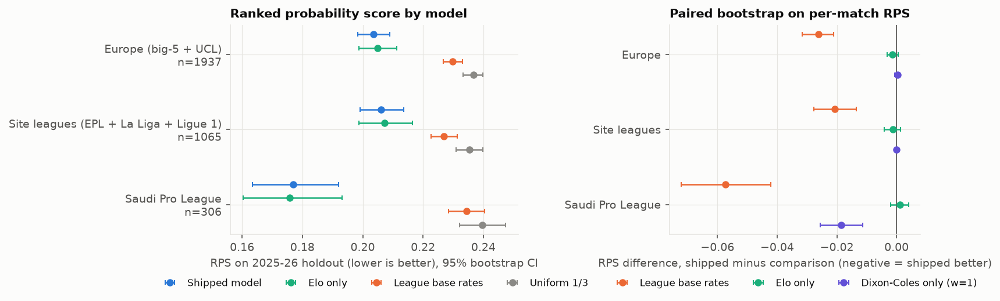

# Ihtimal (احتمالات): pre-specified and hash-locked football match forecasts

Ihtimal publishes win/draw/loss probabilities and a most likely score for every upcoming match in the Saudi Pro League, Premier League, La Liga and Ligue 1, plus two featured Champions League games. The model, the evaluation plan and the weekly "lock" that freezes each forecast before kick-off are all in this repository, so anyone can check that a published forecast was not changed afterwards.

**Live site (Arabic first, static): https://match-predictions.vercel.app**

For fun and learning. It is not betting advice: no odds or market data are used anywhere, and the model was never tested against bookmaker prices.

## Results so far

Every number below is quoted from `EVALUATION.md` and comes from `evaluation/results.json`, which `evaluation/run_eval.py` computes; re-running it reproduces these numbers exactly. Setup: one season (2025-26) held out in advance, weekly walk-forward refits that use only earlier matches, 2,000 match-level bootstrap resamples (seed 2026), 95% intervals in brackets. Data through 2026-10-18 (7,121 matches). RPS is the ranked probability score, log-loss and Brier are the usual scores; lower is better for all three.

| Group | n | W/D/L accuracy | Exact-score hit | RPS | Log-loss | Brier |
|---|---|---|---|---|---|---|
| Europe | 1,937 | 52.2% [50.0, 54.4] | 10.5% [9.1, 12.0] | 0.2036 [0.1984, 0.2090] | 0.9920 [0.9734, 1.0114] | 0.5910 [0.5779, 0.6046] |
| Premier League, La Liga, Ligue 1 | 1,065 | 50.2% [47.2, 53.3] | | 0.2061 [0.1992, 0.2136] | | |
| Saudi Pro League | 306 | 57.5% [52.0, 63.1] | | 0.1770 [0.1634, 0.1919] | | |

Reference points (Europe): RPS 0.2298 for league base rates, 0.2050 for an Elo-only model, 0.2366 for a uniform forecast; "home win always" is right 44.6% of the time. The model beats base rates (RPS difference -0.0262 [-0.0315, -0.0211]) but is **not distinguishable from plain Elo** (-0.0013 [-0.0032, +0.0005]). `EVALUATION.md` lists the other limits: it never names a draw as the most likely result, it is mildly under-confident, and home advantage is understated in the three site leagues. Treat a single percentage as carrying an uncertainty of several points.



## Pre-registration and prospective locking

The honest test of a forecasting model is matches nobody had played when the forecast was made. Two documents fix the plan before outcomes exist:

* `BACKTEST_SPEC.md` pre-specifies the retrospective backtest (with logged amendments); `BACKTEST.md` and `EVALUATION.md` report it.
* `prospective/PROTOCOL.md` (version 1.0, 20 Oct 2026) pre-specifies the prospective study: hypotheses (H1: model RPS below league base-rate RPS; H2: model RPS below Elo-only RPS), the counted forecast (the earliest locked version), the baselines, the metrics, the paired bootstrap with a Bonferroni-adjusted interval, the sensitivity analyses and how postponed or abnormal matches are handled. Its sha256 and registration time are in `prospective/PROTOCOL_REGISTRATION.json`, written before the first locked match kicked off.

How a match is locked:

1. `make predict` writes the forecasts for the next 14 days into `site/data/`.
2. `make prospective-lock` (`prospective/lock_week.py`) writes a dated manifest in `prospective/locks/` for every match that has not kicked off yet: the published probabilities, the score grid, the two baselines, the sha256 of the published file, the UTC lock time and the manifest's own sha256. The earliest lock wins; later refits never replace it and are only logged in `prospective/locks/versions_log.jsonl`.
3. `make verify`, then the site is deployed. `make prospective-attest` fetches the public copies right after the deploy.
4. After full time, `make prospective-score` (`prospective/score.py`) fetches final scores from ESPN's public scoreboard, scores every locked match that has finished and writes `prospective/results.json`, `results_table.csv` and `results_by_league.csv`. It refuses to run if a manifest no longer matches its own hash.

The first manifest (`prospective/locks/2026-10-20_manifest.json`, locked 2026-10-20T11:35:30Z) holds 82 matches (23 Saudi Pro League, 20 La Liga, 19 Premier League, 18 Ligue 1, 2 Champions League) and lists 5 matches that had already kicked off as excluded. The study covers kick-offs from 20 Oct 2026 15:00 UTC to 6 Dec 2026; weekly lock runs continue until 29 Nov. Interim results files are for monitoring, and the final numbers come from one run of the unchanged `score.py` after 20 Dec 2026.

The protocol, its registration record and the first lock manifest (82 matches) were deposited on Zenodo at 13:40 UTC on 20 October 2026, before the first locked kick-off at 15:00 UTC: [doi:10.5281/zenodo.23500445](https://doi.org/10.5281/zenodo.23500445). That deposit is the independent time-stamp; this repository shows exactly what was locked and how to check it. Each later weekly manifest is deposited as a new Zenodo version. The study has a single author and no blinding; `PROTOCOL.md` section 11 states the safeguards and the limits.

## Verify a lock hash

Run these from the repository root with any Python 3 (standard library only).

**1. The protocol is the one that was registered.**

```
shasum -a 256 prospective/PROTOCOL.md
```

The output must equal `protocol_sha256` in `prospective/PROTOCOL_REGISTRATION.json` (`02af6b1ee6b24cf30af3e589ae40135b76a74025efbc7caf60acfd9bd5fe1a9a`).

**2. The manifest has not been edited, and every locked match file is the one that was locked.**

```
python3 - <<'PY'
import json, hashlib
m = json.load(open("prospective/locks/2026-10-20_manifest.json", encoding="utf-8"))
body = {k: v for k, v in m.items() if k != "manifest_sha256"}
canon = json.dumps(body, sort_keys=True, separators=(",", ":"), ensure_ascii=False)
print("manifest self-hash OK:", hashlib.sha256(canon.encode("utf-8")).hexdigest() == m["manifest_sha256"])
bad = [e["match_id"] for e in m["matches"]
       if hashlib.sha256(open("site/data/matches/" + e["file"], "rb").read()).hexdigest() != e["file_sha256"]]
print(len(m["matches"]), "locked matches,", len(bad), "mismatches")
PY
```

The manifest hash is also recorded in `PROTOCOL_REGISTRATION.json` (`first_manifest.manifest_sha256`). For a single match, `shasum -a 256 site/data/matches/<match_id>.json` must equal that entry's `file_sha256`.

**3. The three hash-locked featured games** (PSG v Barcelona, Bayern v Arsenal, Barcelona v Real Madrid) carry their own content hash, which excludes the fields added later (Opta and ClubElo context). Check one file or all three:

```
python3 model/lockutil.py site/data/matches/2026-10-20_psg-barcelona.json
make verify      # all three against site/data/locks.json
```

The first prints the recomputed hash and `OK`. The site also recomputes this hash in the visitor's browser.

Notes. (a) The live site refits every week, so the public copy of an ordinary match file changes after its lock; compare the manifest with the files in this repository or with `versions_log.jsonl`, not with whatever the site serves today. Featured files are never rewritten after their lock. (b) Each manifest records the sha256 of the code that wrote it (`code_sha256`). `model/core.py`, `model/dc.py`, `model/lockutil.py` and `prospective/common.py` match the files here byte for byte. `prospective/lock_week.py` was edited after the first lock run, so it does not match the recorded hash (`0bd4aa07...`); the version that ran is not in this repository.

## Reproduce

Python 3.11 or newer (the lock manifest records Python 3.11.16, numpy 2.4.6, pandas 3.0.6).

```
python3 -m venv .venv
.venv/bin/pip install -r requirements.txt
.venv/bin/pip install -r evaluation/requirements.txt    # matplotlib, only for the evaluation figures
```

| Command | What it does |
|---|---|
| `make backtest` | leak self-check, then the pre-registered walk-forward backtests (Europe and Saudi); rewrites `data/backtest_*` and `BACKTEST.md`. Takes a few minutes and runs from the committed `data/matches.csv`. |
| `.venv/bin/python evaluation/run_eval.py` | the full evaluation: `evaluation/results.json`, `evaluation/figures/` and `EVALUATION.md` (about a minute). `--compute-only` and `--report-only` split the two halves. The numbers and figures reproduce exactly (only run-time fields such as `compute_seconds` differ). The committed `EVALUATION.md` also has several passages marked "(reviewer-corrected)" that were edited in by hand after the script ran, so a re-run rewrites the file without them. |
| `make h2h-test` | the head-to-head experiment (BACKTEST_SPEC.md Amendment 2: not accepted). |
| `make fetch` | re-downloads openfootball and ESPN results into `data/raw/` (not in this repo), rebuilds `data/matches.csv` and asserts the counts. Needs internet; a later fetch will contain newer matches than the committed snapshot. |
| `make serve` | previews the site at http://localhost:8000. |

`make predict`, `make lock`, `make score` and the `prospective-*` targets are the author's weekly routine. They rewrite files under `site/` and `prospective/`, so run them in a scratch copy, not in a checkout you want to keep matching the manifests.

## Repository map

| Path | What it is |
|---|---|
| `model/` | Python pipeline: time-decayed Dixon-Coles goals model (numpy/scipy), Elo leg, backtest, locking and scoring helpers. |
| `evaluation/` | `run_eval.py` and `write_report.py`, `results.json`, `holdout_predictions_2025-26.csv`, figures. |
| `prospective/` | `PROTOCOL.md`, `PROTOCOL_REGISTRATION.json`, `locks/` (manifests and version log), `lock_week.py`, `score.py`, results files. |
| `site/` | The static website exactly as deployed (HTML, CSS, vanilla JS, JSON). `site/data/SCHEMA.md` documents every JSON file. |
| `inputs/` | Hand-entered team news, xG and featured-game inputs, each with a source URL and check date. |
| `data/` | Processed tables and backtest output only: `matches.csv`, `team_meta.json`, `fixtures_raw.json`, `build_report.json`, `backtest_*`, `h2h_*`. |
| `BACKTEST_SPEC.md`, `BACKTEST.md`, `EVALUATION.md` | Pre-specified backtest, its results, and the full evaluation. |

## Data sources and licences

Code: MIT (`LICENSE`). Data and third-party material: see `DATA_LICENSE.md`. In short: openfootball results are public domain (CC0); match scores from ESPN's public scoreboard are factual results used for research, and no ESPN content or odds are redistributed; team crests in `site/assets/logos` are trademarks of their clubs, used for identification only (`site/assets/logos/CREDITS.md`); flags come from flag-icons (MIT); player photos are not part of this repo. Team news, xG (statz.ai), ClubElo and Opta / The Analyst figures are typed in by hand with their source URL and are credited on the site; the first two feed the three featured games only.

## Cite

See `CITATION.cff`. Mohammed Hashem Mohammed Al Kuhali, independent researcher, Birmingham, UK. ORCID 0009-0008-2632-8350.

## AI use

Generative AI tools assisted with code and language editing; the author reviewed all outputs and takes full responsibility for the content.
